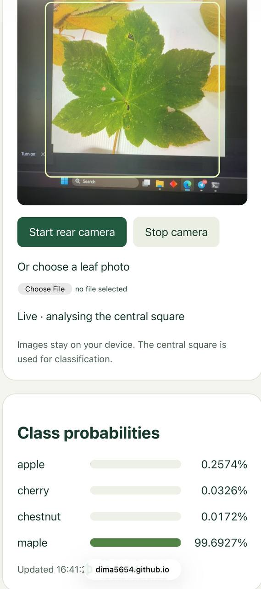

Leaf classifier review

My page: https://dima5654.github.io/mlr-ex08/

Repository: https://github.com/dima5654/mlr-ex08

The screenshot and probability table below are from the original Task 2 model. Its four files are kept in [task2_original/](task2_original/), including the [original expected probabilities](task2_original/check_expected.json). The page's root files now contain the Task 4 model and its new expected probabilities. Its new phone test will be recorded separately in REPORT.md.

1. Testing on my phone

I opened the Pages URL on my phone and pointed the camera at a leaf picture on my laptop. The probabilities updated live. In the screenshot, maple has the highest probability at 99.6927%. I also scanned the QR code at the bottom of the page and checked that it opens my app's exact URL.

At first, double-clicking index.html on my laptop gave “Failed to fetch”. Running it through the local server fixed this. On the phone I use the HTTPS Pages URL. The page requests the rear camera and also lets me choose a photo if the camera is unavailable.

2. Comparing the probabilities

I ran the reference check on both my laptop and phone. I also uploaded check_image.jpg using the photo input and got the same results. Here they are next to check_expected.json:

| Class | Expected probability | Laptop | Phone | Both rounded to 3 decimals |
| --- | ---: | ---: | ---: | ---: |
| apple | 0.70185935 | 0.70186182 | 0.70186182 | 0.702 |
| cherry | 0.28628042 | 0.28627789 | 0.28627789 | 0.286 |
| chestnut | 0.01177154 | 0.01177158 | 0.01177158 | 0.012 |
| maple | 0.00008872 | 0.00008872 | 0.00008872 | 0.000 |

All four agree to three decimals. The biggest absolute difference is about 0.00000254. Both devices show PASS and the same input fingerprint, `2c5a843a`. The page displays percentages, so a probability of 0.70186182 appears as 70.1862%.

The first phone check failed: apple was 0.70725353 and cherry was 0.28032867. Different JPEG decoding between browsers seemed to be the cause. The page was changed to use MozJPEG WASM 1.6.0 for JPEG files on both devices. After that, the results matched. The expected values and the check's tolerance of 0.005 were not changed.

3. Checking the preprocessing

The preprocessing is in [preprocess() in index.html](index.html#L35). These are the steps:

1) `side = Math.min(w,h)` finds the size of the central square. The crop starts at `((w-side)/2, (h-side)/2)`.
2) `ctx.drawImage(...)` crops that square and resizes it to `size × size`. The size comes from model_info.json and is 96, so the result is 96 × 96.
3) `rgba[4*i+c] / 255` scales each RGB value to 0–1.
4) `(rgba[4*i+c]/255 - info.mean[c]) / info.std[c]` standardizes each channel. The mean is `[0.485, 0.456, 0.406]` and the std is `[0.229, 0.224, 0.225]`, read directly from model_info.json.
5) `data[c*area+i]` puts all red pixels first, then green, then blue. Alpha is skipped. The float32 tensor has shape `[1,3,96,96]`, so the order is NCHW.

A JPEG that is already 96 × 96 does not need cropping or resizing, so its decoded pixels go directly to normalization. Camera frames and larger images go through the crop and resize steps. The JPEG fix did not change the normalization or channel order.

These settings match [model_info.json](model_info.json). The supplied notebook uses `Compose([ToTensor(), Normalize(mean, std)])` on images already centre-cropped and resized to 96 × 96 by the dataset preparation step. ToTensor divides by 255 and changes RGB to CHW, matching the page's normalization and channel order. The notebook does not resize these images at runtime, so matching the check image does not prove identical interpolation for larger camera frames.

4. Do images leave the phone?

The image handling and network calls in index.html were checked. Camera frames are processed in the browser with canvas and ONNX Runtime. Choosing a photo creates a local `blob:` URL; it does not upload the file. There is no image-upload request or remote prediction API in the page.

The page does download files to run:

| URL loaded | Purpose |
| --- | --- |
| `https://dima5654.github.io/mlr-ex08/` | The web page |
| The same URL plus `leaf_model.onnx` and `model_info.json` | The model, class names and preprocessing settings |
| The same URL plus `check_image.jpg` and `check_expected.json` | The reference image and expected results when running the check |
| `https://cdn.jsdelivr.net/npm/onnxruntime-web@1.20.1/dist/` | ONNX Runtime JavaScript and its WASM files |
| `https://cdn.jsdelivr.net/npm/@jsquash/jpeg@1.6.0/` | The JPEG decoder and its WASM files |
| `https://cdn.jsdelivr.net/npm/qrcode-generator@1.4.4/qrcode.js` | The library that draws the QR code locally |

The hosting and CDN services receive normal web requests, including connection information such as the IP address, but the app does not send them the leaf images or predictions. This conclusion comes from checking the code; I have not captured a phone network log.

No image-upload feature needed to be removed. The QR is also generated in the browser, without an external QR-image service.

Submission

The public repository contains the app and the four supplied files. README.md has the Pages URL, and this review includes the phone screenshot. MLRteacher has been invited as a collaborator. Task 4 is being left for later. The notebook transform comparison above still needs to be completed.
